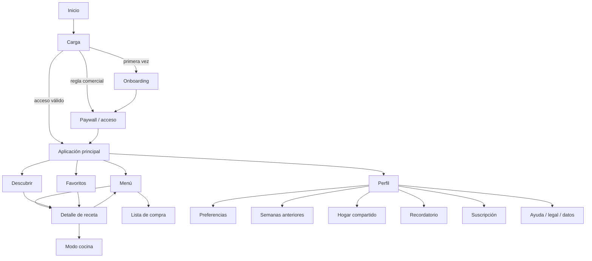

# Inventario funcional de Whipp 1.4.5

Este documento describe lo observado en el APK exacto. No convierte código decompilado en código del producto nuevo; solo registra comportamiento, estructura y contratos necesarios para interoperabilidad funcional.

## 1. Aplicación y plataforma

| Elemento | Evidencia | Resultado |
|---|---|---|
| Paquete / versión | Comprobado-estático | `app.whipp`, 1.4.5, código 14 |
| SDK | Comprobado-estático | minSdk 32, targetSdk 36, compileSdk 37 |
| Actividad principal | Comprobado-estático | `app.whipp.MainActivity`, exportada, `singleTask`, retrato, `adjustResize` |
| Diseño ancho | Comprobado-estático | orientación y navegación se adaptan cuando el ancho mínimo es de tableta |
| Estados raíz | Comprobado-estático | `onboarding`, `loading`, `gate`, `main` |
| Estado persistido | Comprobado-estático | preferencias, historial, onboarding completado, favoritos y espera de primera compra |
| Almacenamiento | Comprobado-estático | archivo privado `Whipp`, preferencias `cookWays` y `whipp.household` |
| Arranque dinámico | Comprobado-runtime | instalación por splits posible; apertura bloqueada/redirigida por Play Integrity al no proceder de Google Play |

## 2. Grafo de navegación

En anchura compacta se usan cuatro destinos inferiores; en anchura amplia se muestran como pestañas superiores. Esto está comprobado estáticamente.

## 3. Pantallas

### Onboarding

El enum de referencia contiene nueve pasos:

1. `zip`: código postal; solo para mercado estadounidense y configuración inicial.
2. `shop`: tienda.
3. `budget`: presupuesto semanal.
4. `days`: días de cocina.
5. `priorities`: objetivos y preferencias.
6. `kitchen`: equipamiento disponible.
7. `reviews`: intersticial condicional de confianza/reseñas en la configuración inicial.
8. `diet`: dieta y alergias.
9. `dislikes`: ingredientes o categorías no deseadas.

Validaciones comprobadas: ZIP resoluble cuando aparece; tienda obligatoria; al menos un día; al menos una prioridad; al menos un equipo. Presupuesto, dietas y exclusiones pueden continuar con su valor actual. La última acción crea el plan.

### Menú semanal

Comprobado-estático mediante modelos, recursos localizados y handlers:

- semana actual, anterior y siguiente;
- regenerar semana;
- añadir un plato;
- cambiar un plato;
- marcar como cocinado;
- omitir/restaurar;
- raciones por comida;
- estimación gastada, presupuesto y señal de exceso;
- apertura de receta y lista de compra;
- enlace desde notificación a una semana concreta.

El algoritmo exacto de ranking y construcción del plan no quedó probado; es **inferido** que pondera prioridades, dietas, tienda, presupuesto, equipos, exclusiones, familiaridad y variedad porque todos esos campos confluyen en el modelo y los recursos.

### Descubrir

Comprobado-estático:

- búsqueda de platos, cocinas o etiquetas;
- exploración por cocina y preferencias;
- filtros;
- estado con coincidencias y sin coincidencias;
- abrir receta, añadir a la semana y marcar favorito.

### Favoritos

Comprobado-estático:

- colección persistida de IDs de receta;
- añadir/quitar mediante corazón;
- estado vacío;
- apertura del detalle.

### Detalle de receta

Comprobado-estático:

- nombre, descripción, imagen, tiempo, raciones, calorías y macronutrientes;
- ingredientes y método;
- escalado por número de raciones;
- variantes de mercado/idioma cuando existen;
- favorito, añadir al menú e iniciar cocina paso a paso.

### Modo cocina

Comprobado-estático:

- posición persistible: receta, paso, mercado, raciones y datos auxiliares;
- avance/retroceso por pasos;
- temporizadores por receta/paso;
- iniciar, pausar, reanudar, girar y finalizar;
- receptor dedicado de alarma y acción de notificación `OPEN_COOK`.

Los detalles visuales exactos y el comportamiento con la app en segundo plano no pudieron comprobarse dinámicamente.

### Lista de compra

Comprobado-estático:

- agregación de ingredientes;
- agrupación por pasillos: fruta/verdura, carne/pescado, refrigerados/lácteos, panadería, despensa, congelados y otros;
- marcar artículos;
- artículos propios adicionales;
- estimación total;
- combinar semanas;
- compartir/exportar;
- salto a compra online;
- estados bloqueados vinculados al plan gratuito/premium.

Precios actuales, disponibilidad y cesta online son **externos**.

### Perfil y ajustes

Comprobado-estático:

- editar preferencias;
- ver planes anteriores;
- hogar compartido;
- recordatorio semanal;
- ayuda y feedback;
- soporte, privacidad y términos;
- versión;
- gestionar suscripción;
- borrar datos/empezar de nuevo.

El recordatorio está comprobado estáticamente con más detalle: usa la preferencia `planReminder.enabled`; sus valores predeterminados de día y minuto son 6 y 600. El cálculo parte del lunes, por lo que el día 6 corresponde al domingo, a las 10:00. Se preparan ocho avisos futuros y existe recuperación tras reinicio. El texto visual exacto de la notificación no se considera comprobado dinámicamente.

### Hogar compartido

Comprobado-estático:

- crear código y unirse mediante código;
- listar dispositivos;
- sincronizar plan, lista y preferencias;
- salir o dejar de compartir;
- asociado a acceso premium.

Transporte, autenticación anónima, reglas de conflicto y almacenamiento remotos son **externos**. No se reutilizan Firebase ni contratos privados.

### Acceso y suscripción

Comprobado-estático:

- estado raíz `gate`;
- vista previa/plan gratuito con elementos bloqueados;
- compra y gestión de suscripción;
- BillingClient y Superwall presentes.

Productos, precios, elegibilidad y restauración son **externos**. No se copió ninguna clave de configuración.

## 4. Estados funcionales

| Área | Estados comprobados | Estados inferidos o no observables |
|---|---|---|
| Inicio | onboarding, loading, gate, main | temporización visual exacta de splash |
| Plan | semana, comidas, cocinado, omitido, raciones, sobre presupuesto | función exacta de puntuación |
| Lista | marcado, extra, vacío, estimación, bloqueo premium | política exacta de redondeo/precio vivo |
| Receta | favorito, raciones, paso de cocina | tratamiento exacto de sustituciones |
| Temporizador | activo, pausado, restante, terminado | persistencia bajo restricciones OEM |
| Descubrir | consulta, filtros, resultados, vacío | orden exacto de búsqueda |
| Hogar | sin hogar, creador, unido, dispositivos, salir | protocolo privado y conflictos |
| Compra | libre, vista previa, bloqueado, suscrito | catálogo actual de productos |
| Errores | mensajes localizados y reintento | textos/animaciones exactos no visibles en runtime |

## 5. Modelo de datos comprobado

### Preferencias

Tienda, presupuesto, personas, prioridades, dietas, equipos, exclusiones, comidas por día, días de cocina, apto para niños, aceptación del aviso de alergias, ingredientes ya disponibles, planificar con lo disponible y código postal.

### Plan semanal

ID, fecha de creación, inicio de semana, tienda, presupuesto, personas, comidas, gasto estimado, exceso de presupuesto, artículos marcados, artículos extra y comidas por día.

### Comida planificada

ID, ID de receta, día, franja, cocinada, omitida y raciones.

### Receta

ID, nombre, descripción, imagen, raciones, calorías, tiempo, proteína, hidratos, grasa, etiquetas, dietas, prioridades, equipos, ingredientes, pasos, cocina, proteína, nivel de coste, familiaridad, dietas exclusivas, familia, picante, una sartén, ligera, localizaciones US, mercado, variantes, necesidades, métodos, nutrición y señal antiinflamatoria.

## 6. Taxonomías comprobadas

- Mercados: Reino Unido, Estados Unidos, Australia, Canadá y España.
- Prioridades: rápida, alta en proteína, familiar, saludable, baja en hidratos, digestiva, reconfortante, vegetal, batch cooking y antiinflamatoria.
- Dietas/restricciones: vegetariana, vegana, pescetariana, sin gluten, sin lácteos, sin frutos secos, sin cerdo, halal, kosher, baja en FODMAP, keto, sin pescado, sin marisco, sin vacuno, sin cordero y sin aceites de semillas.
- Alérgenos: gluten, lácteos, frutos secos, pescado, marisco, huevos, soja, sésamo y cerdo.
- Equipos: horno, fogones, freidora de aire, microondas y arrocera.
- Nivel de receta: económico, cotidiano y capricho.
- Familiaridad: base, variedad y especialista.
- Picante: ninguno, suave, medio y fuerte.

## 7. Recursos

| Recurso | Comprobado-estático |
|---|---:|
| Clases en `base.apk` | 9.333 |
| Recursos totales inventariados | 1.566 |
| Recetas JSON | 948 |
| Fotografías WebP de recetas | 848 |
| Cadenas españolas | 626 |
| Fuentes incluidas | DM Serif Display, Hanken Grotesk e Instrument Serif, con variantes |
| Datos adicionales | paquetes/precios por mercado, nutrición por ingrediente y base ZIP/tienda US |

Imágenes, iconos de marca, logotipos de tiendas, fuentes empaquetadas y textos creativos se consideran protegidos y no se copiaron. Weekplate usa formas generativas, tipografías del sistema y contenido original.

## 8. Servicios y permisos externos

Detectados: Firebase Auth, Firestore, Functions, Crashlytics, Installations y Sessions; Google Sign-In; BillingClient 9.1.0; Superwall; WorkManager; Room; notificaciones; Play Integrity/Pairip.

Permisos de la referencia: Internet, red, notificaciones, recepción tras arranque, alarmas exactas, wake lock, foreground service, mensajería Google, facturación/licencia e install referrer. Weekplate 0.2 usa Internet, estado de red, notificaciones, recepción tras arranque, alarma exacta, wake lock y foreground service para sus recordatorios y WorkManager; AndroidX añade un permiso interno de receptor no exportado. No declara mensajería, facturación, licencia ni servicios privados de la referencia.

## 9. Deep links e intents comprobados

- `app.whipp.OPEN_COOK` con `recipeID` y `step` abre una receta en modo cocina.
- `app.whipp.action.OPEN_FROM_NOTIFICATION` usa `whippKind`, `whippWeekStart` y `whippWeekID`; el tipo `shop` abre la lista de la semana válida.

No se implementaron esos nombres de acción para evitar fingir compatibilidad de protocolo o apropiarse del namespace de la referencia.
